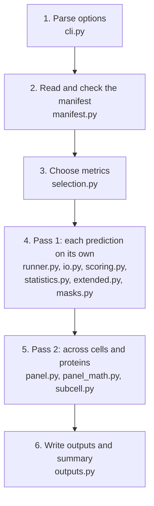

# Architecture

How the package in `src/cm4ai_evaluate` is put together, for people changing the code. For what the metrics mean, see [metrics.md](metrics.md).

## A run in six stages



1. **Parse options.** `cli.main()` reads the command line, runs the stages below in order, prints the run summary, and sets the exit code: 0 every row scored, 1 some rows not scored, 2 the manifest or setup is unusable.
2. **Read the manifest.** `manifest.read_manifest()` turns each CSV or JSON row into a `ManifestRow`: paths resolved relative to the manifest's folder, `prediction_id`, `cell_id` (the row's own `prediction_id` unless given), `group_id`, and the reference channels. It stops with a `ManifestError` if required columns are missing, ids repeat, reference columns are incomplete, or the rows of one cell disagree.
3. **Choose metrics.** `selection.resolve()` turns `--metrics` into two lists, pair metrics and panel metrics, and notes those whose packages are not installed. `cli` then drops panel metrics whose inputs are absent (no `group_id`, no reference channels, no location head), with a message for each, and loads Inception or SubCell only if a chosen metric needs it.
4. **Pass 1, per prediction.** For each row, `runner.score_row()` reads and checks the images (`io.read_image`, `io.check_pair`, `io.read_mask`) in strict or lenient mode, then calls `scoring.score_pair()`, which runs every chosen pair metric on the whole image and inside the mask. The result is one record per row. A row that fails a check becomes an error record and the run continues.
5. **Pass 2, across the manifest.** `panel.score_panel()` groups rows into cells (`build_cells`), loads each cell's ground truth, mask and reference channels once, computes brightness spread against the other cells of the same protein (`score_brightness`), and runs SubCell once per cell on the truth plus all its predictions in one batch (`score_subcell`): pattern distance and location divergence for each prediction, the energy score for the cell. Per-image values are added to the records' `masked_metrics`; per-cell values are returned separately.
6. **Write outputs.** `outputs.write_jsonl` and `write_csv` write one row per prediction; `cell_summary` and `group_summary` build the per-cell and per-protein tables, which `write_table` writes.

## Modules

| Module | Role | Main contents |
|---|---|---|
| `__init__.py` | Package version | `__version__` |
| `cli.py` | Entry point; runs the stages | `build_parser`, `main`, `_panel_requirements`, `_summary` |
| `manifest.py` | Manifest reading and checks | `read_manifest`, `ManifestRow`, `Manifest`, `ManifestError` |
| `selection.py` | Which metrics run | `resolve`, `TIERS`, `Selection`, `SelectionError` |
| `io.py` | Image and mask reading; strict and lenient checks ([input-checks.md](input-checks.md)) | `read_image`, `read_mask`, `check_pair`, `LoadedImage`, `Deviation`, `ImageCheckError` |
| `scoring.py` | Pair metric registry; scores one image pair | `METRICS`, `Metric`, `score_pair`, `extra_installed`, tier names |
| `statistics.py` | The nine grading statistics, on 0 to 255 values | `compute_statistics`, `STATISTIC_NAMES` |
| `extended.py` | Metrics ported from the ProtiCelli notebook, and Inception | `pearson_r`, `spearman_r`, `psnr_db`, `ms_ssim`, `mutual_information_nats`, `haralick_similarity`, `gabor_similarity`, `InceptionFeatureExtractor`, `MetricResult` |
| `masks.py` | How each pair metric is masked | pixel subset, bounding box `crop`, exact co-occurrence for Haralick |
| `runner.py` | One manifest row into one record | `score_row` |
| `panel.py` | Panel metric registry and pass 2 | `PANEL_METRICS`, `PanelMetric`, `score_panel`, `score_brightness`, `score_subcell`, `Cell` |
| `panel_math.py` | Numpy math of the panel metrics, matching `dream_eval` | `brightness_cdf`, `brightness_reference`, `brightness_spread_w1`, `pattern_distance`, `location_divergence`, `energy_score` |
| `subcell.py` | SubCell model and features (needs the `[subcell]` extra) | `SubCellExtractor`, `ensure_weights`, `load_location_head` |
| `outputs.py` | Output files | `write_jsonl`, `write_csv`, `cell_summary`, `group_summary`, `write_table` |

Only `cli.py` imports `subcell.py` and `extended.InceptionFeatureExtractor`, and only when a chosen metric needs them, so the basic tier runs without torch.

## Ideas that tie it together

**The record.** One dict per prediction: `prediction_id`, `status`, `metrics` (unmasked), `masked_metrics`, `masked_methods`, `notes`, `deviations`, `error`, and the input paths. Pass 1 creates it, pass 2 adds to `masked_metrics`, and it is written unchanged as one line of `PREFIX.jsonl`; `PREFIX.csv` flattens it.

**Two registries.** Metrics are listed in exactly two places: `scoring.METRICS` (pair metrics) and `panel.PANEL_METRICS` (panel metrics). Output columns, tiers and the names `--metrics` accepts are all derived from them.

**Pair or panel.** A pair metric needs only one prediction and its ground truth, so it runs in pass 1, on the whole image and inside the mask. A panel metric needs other rows (the other cells of the protein, the other predictions of the cell) or a model run once per cell, so it runs in pass 2, inside the mask only.

**Levels.** Per image (`PREFIX.csv`), per cell (`PREFIX_cells.csv`), per protein (`PREFIX_groups.csv`); see [metrics.md](metrics.md#three-levels-of-assessment).

## Adding a metric

- **Pair metric:** write a function `f(prediction, ground_truth) -> MetricResult` (in `extended.py` or a new module) and add one `Metric` entry to `scoring.METRICS`: output names, the function, the extra it needs, the value scale (`UNIT` for [0, 1], `RAW` for 0 to 255), and the masked method (`masks.PIXELS`, `masks.BOUNDING_BOX` or `masks.GLCM`).
- **Panel metric:** add the math to `panel_math.py`, a `PanelMetric` entry to `panel.PANEL_METRICS` (name, level, category, extra, inputs it needs, panel name), and the computation to `panel.score_panel` or one of its helpers.
- In both cases: tests in `tests/`, and a row in [metrics.md](metrics.md) (direction, range, what it measures, source).

## Tests

Install with the development tools, then run `pytest` from the repository folder:

```
pip install -e ".[extended,inception,dev]"
pytest
```

Without torch, the SubCell model test and the Inception tests are skipped; the SubCell bookkeeping is tested with a stand-in extractor (`tests/test_panel_subcell.py`). To include the real SubCell model:

```
CM4AI_SUBCELL_WEIGHTS=/path/to/all_channels_MAE-CellS-ProtS-Pool.pth pytest
```

## Verification

- The grading statistics reimplement the challenge grader in `cm4ai-anvil-dream-tools` (cited by commit in the code) and give identical values on 203 image pairs.
- The other metrics are ported from the ProtiCelli quality evaluation notebook and give identical values to its own functions on real image pairs.
- The panel metrics reimplement the evaluation team's preliminary panel (`dream_eval` 0.3.0) and give identical values to its functions: brightness spread on 400 images; SubCell features, bit for bit, on 32 images.
- Run on all 200 sample cells with BLAST-ProtiCelli predictions, masked and unmasked, with Inception.
